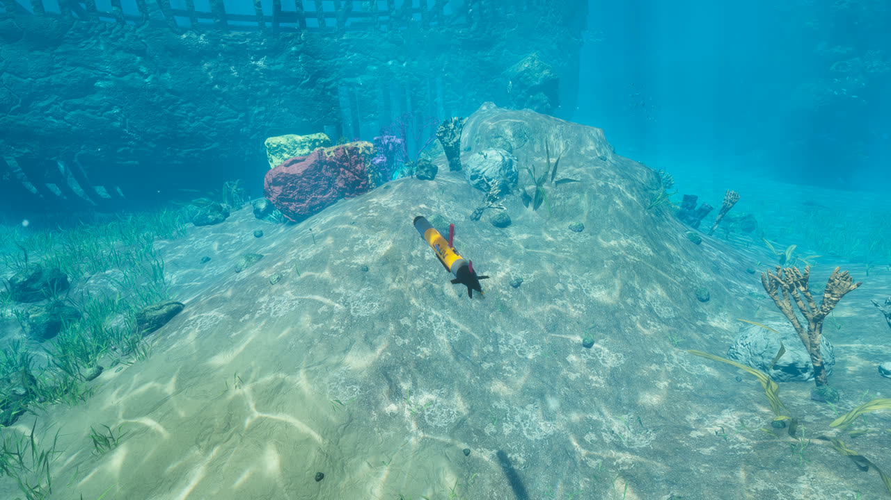
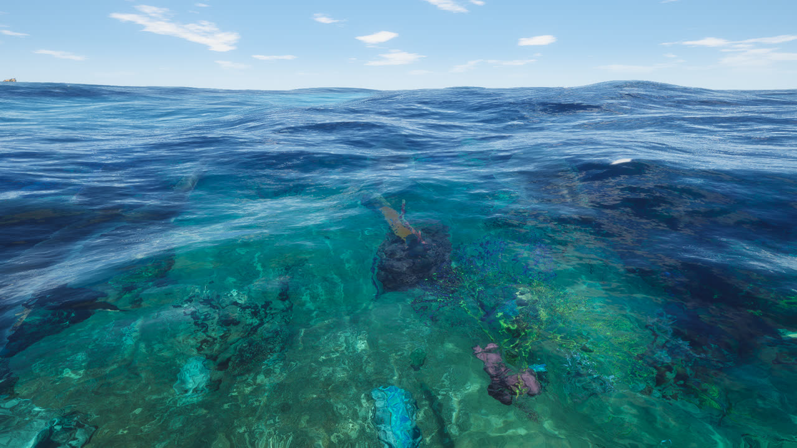
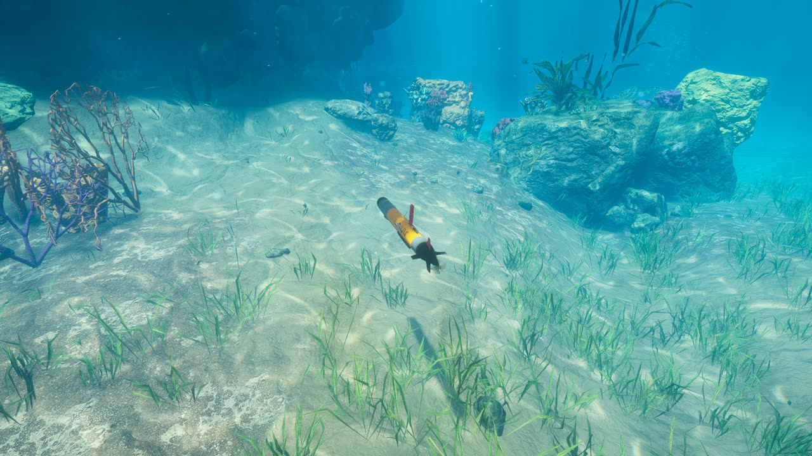
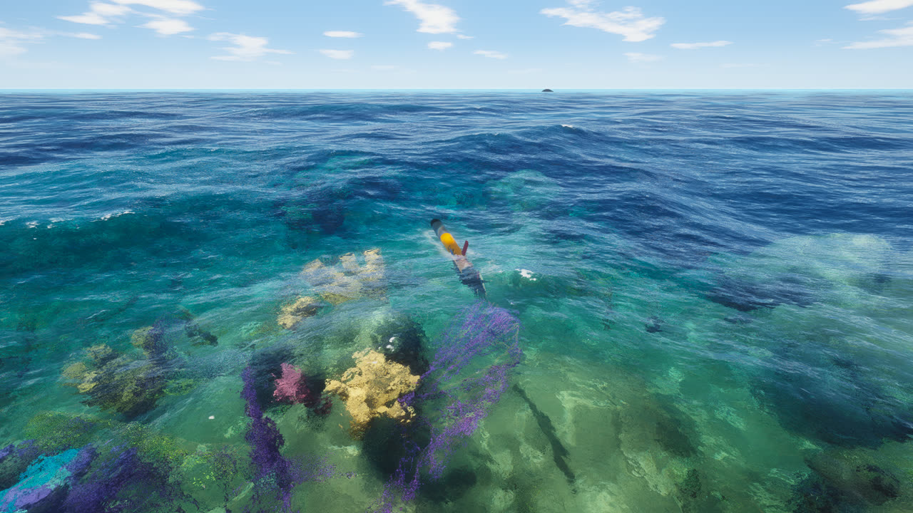

# LAUV Aquarium

**Drive an OceanScan LAUV through an endless reef, right in your browser.**

**[Play it on GitHub Pages](https://zepinto.github.io/lauv-aquarium/)** (Chrome or Edge with WebGPU)



You pilot a light autonomous underwater vehicle (LAUV) through rock outcrops, kelp, coral and a wreck. Fish schools and sardine bait balls part around it, dolphins come over to ride its wake, rays lift off the sand, and octopuses flash, ink and hide. There is no score: explore without scratching the hull. The reef repeats seamlessly in every direction, so you can keep going forever.

The vehicle flies like the real one. It has to keep moving to dive and turn, it holds its roll at zero by itself, kelp can foul the propeller (reverse to clear it), and it scrapes on rocks and the seabed. At the surface it floats awash on a GPU-simulated ocean and is seen from above the water.

| | |
|---|---|
|  |  |



## Controls

| | Keyboard | Touch |
|---|---|---|
| Turn left / right | `←` `→` (or `A` `D`) | Second finger: 4-way stick |
| Climb / dive | `↑` `↓` (or `E` `Q`) | Second finger: 4-way stick |
| More / less thrust | `W` / `S` (hold `S` to reverse) | First finger: throttle slider |
| Change camera (chase, free, side, front) | `C` | |
| Jump to a viewpoint | `1` to `6` | |
| Menu | `Esc` | `≡` button |
| Sound on / off | `M` | |
| Performance stats | `H` | |

URL options: `?octo=1` to `?octo=6` starts next to one of the six octopuses, `?res=1` renders at full resolution, `?hud=0` hides the overlay.

## What's in it

- **The vehicle:** the OceanScan LAUV model with propeller, fins and buoyancy physics, automatic roll control, collisions and propeller fouling.
- **The sea:** a GPU FFT ocean (JONSWAP spectrum in three cascades) with foam, Fresnel reflections, refraction and the vehicle's wake.
- **The reef:** a seabed sculpted on the GPU and textured with CC0 rock and sand scans from Poly Haven, with soft shadows, ambient occlusion, sun shafts and caustics.
- **The animals:** fish schools and bait balls, dolphins, eagle rays, stingrays, mantas and octopuses, each reacting to the vehicle.
- **The renderer:** WebGPU directly, with no game engine or 3D library, temporal anti-aliasing and dynamic resolution. It runs at 1920×1080 above 30 fps on an Intel Arc 140T integrated GPU.

## Build it yourself

The readable source is in [`source/src`](source/src). You need [Node.js](https://nodejs.org) 18 or newer:

```bash
cd source
npm install
npm run build
```

This writes `index.html`, `lauv-omst.glb` and `textures/` next to this README. Serve the folder over HTTP, for example with `python3 -m http.server`, and open it in Chrome or Edge. Opening the file directly doesn't work because the page loads the model and textures with `fetch`. `npm run build:readable` writes an unminified build for debugging.

| File | What's inside |
|---|---|
| [`source/src/lauvphys.js`](source/src/lauvphys.js), [`source/src/lauv.js`](source/src/lauv.js) | Vehicle physics, controls, cameras, collisions |
| [`source/src/world.js`](source/src/world.js), [`source/src/look.js`](source/src/look.js) | The reef layout and its materials |
| [`source/src/surface.js`](source/src/surface.js) | The FFT ocean surface |
| [`source/src/fauna/`](source/src/fauna) | The animals |
| [`source/src/touch.js`](source/src/touch.js) | Touch controls |
| [`source/src/main.js`](source/src/main.js), [`source/src/shaders.js`](source/src/shaders.js) | Renderer and shaders |

## Credits and licences

- Built on [Abyssal Garden](https://github.com/Noniv/abyssal-garden) by Maksymilian Dendura ([MIT](LICENSE)).
- Rock and sand textures: [Poly Haven](https://polyhaven.com), CC0. The authors are listed in [LICENSES](LICENSES).
- The LAUV model (`lauv-omst.glb`) belongs to OceanScan-MST and is published here with its permission. It isn't covered by the MIT licence.
